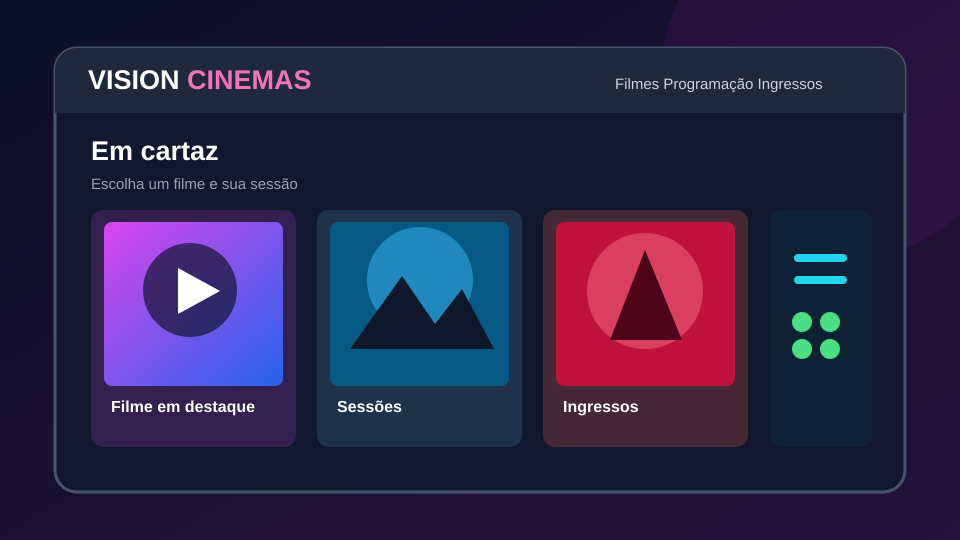
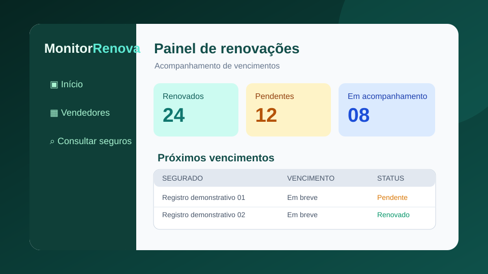

# Portfólio de Bruno Roberto Cataneo

Sou estudante de Ciência da Computação na UNOESC e trabalho com suporte e infraestrutura de TI. Meu portfólio reúne projetos de desenvolvimento, automação e experiências profissionais.

**[Acessar o portfólio online](https://brunorobertocataneo.github.io/meu-novo-portfolio/)**

## Projetos em destaque

| Vision Cinemas | MonitorRenova |
| --- | --- |
| [](https://github.com/brunorobertocataneo/REDE-CINEMA-FINAL) | [](https://github.com/brunorobertocataneo/Monitorrenova) |
| Sistema de cinema com sessões e escolha de assentos, feito com Java, Spring Boot e MySQL. | Sistema acadêmico de acompanhamento de renovações de seguros, com filtros, histórico e uma demonstração independente de automação no n8n. |

### Outros projetos

- [Nosso Grande Dia](https://github.com/brunorobertocataneo/nosso-grande-dia.) — protótipo de lista de presentes com cotas simuladas.
- [ERS Seguros](https://brunorobertocataneo.github.io/ERS/) — site responsivo de uma corretora.
- [Olhar Cultural](https://brunorobertocataneo.github.io/olhar_cultural/)
- [Calculadora](https://brunorobertocataneo.github.io/Calculadora/)
- [Jogo da Memória](https://brunorobertocataneo.github.io/programming_memory_game/)
- [IA na Educação](https://brunorobertocataneo.github.io/I.A-NA-EDUCACAO/)

## Tecnologias do portfólio

HTML, CSS e JavaScript, com layout responsivo e publicação no GitHub Pages.

## Executar localmente

```bash
git clone https://github.com/brunorobertocataneo/meu-novo-portfolio.git
cd meu-novo-portfolio
```

Abra o arquivo `index.html` no navegador.

## Contato

[LinkedIn](https://www.linkedin.com/in/bruno-roberto-cataneo-0b38132a5/) · [E-mail](mailto:bruno31.cataneo@gmail.com) · [WhatsApp](https://wa.me/qr/VEIMALFZP7C6N1)
